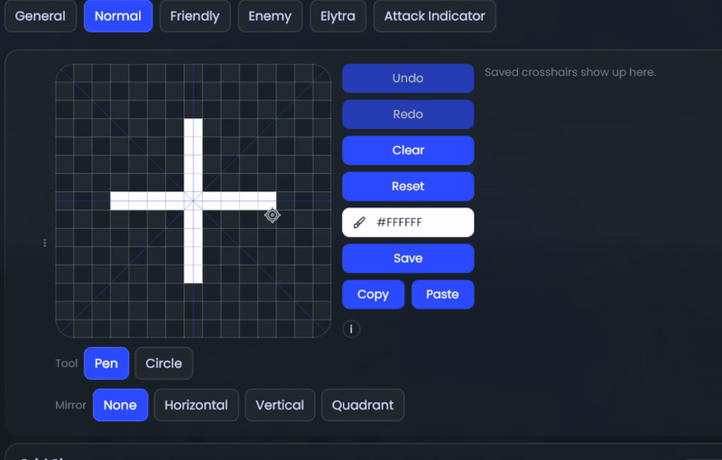
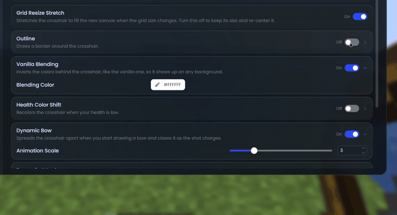
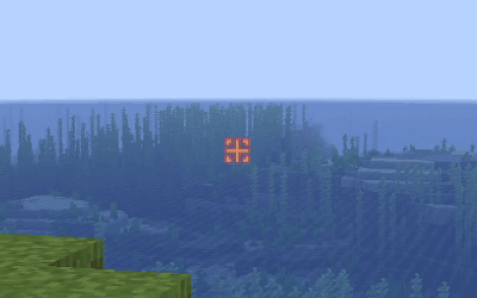

# PolyCrosshair

PolyCrosshair lets you draw your own crosshair in a built-in pixel editor.

### Editor

- Four canvas sizes, from 7x7 up to 63x63
- A pen and a circle tool
- Mirror your strokes horizontally, vertically or both
- Undo and redo
- Save the crosshairs you like and load them back later

Shortcuts in the editor:

- `Delete` clears the canvas
- `S` shows or hides the guide lines
- Hold `Shift` to lock a stroke to one direction
- `Z` and `Y` undo and redo
- `W` switches the mirror mode
- `C` switches between pen and circle

### More crosshairs

- Draw separate crosshairs for when you look at a friendly or an enemy target (teammates and animals count as friendly)
- An elytra indicator below the crosshair while you're wearing one (1.21.1+)

### Options

- Outline with a custom color and thickness
- Vanilla-style blending that inverts the colors behind the crosshair
- Change color when your health gets low
- Dynamic crosshair that spreads while you draw a bow or after you attack (attack not on 1.8.9)
- Custom scale that ignores your GUI scale
- Show it in third person and while spectating

## Supported versions

- Minecraft 1.8.9 on Ornithe.
- Minecraft 1.21.1-26.3 on Fabric.

PolyCrosshair needs [OneConfig](https://modrinth.com/mod/oneconfig) and Fabric Language Kotlin.

## Support

- Report bugs and ask questions on the [Polyfrost Discord](https://polyfrost.org/discord).
- Check [Polyfrost Status](https://status.polyfrost.org/) if a Polyfrost service is down.
