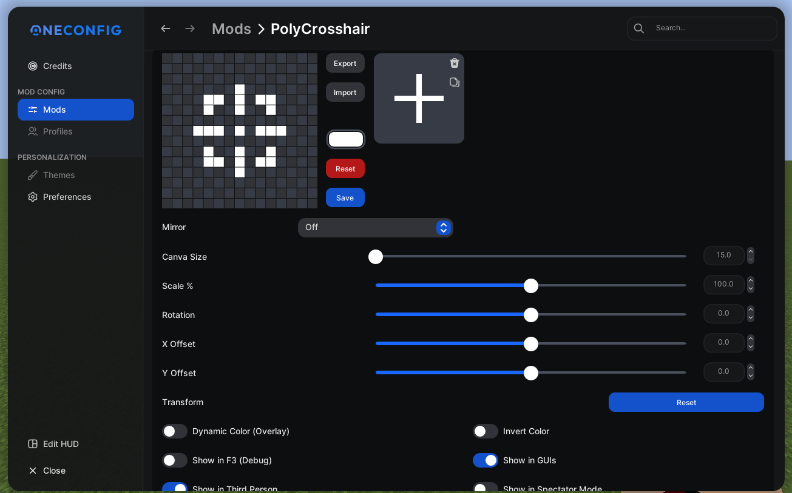

# PolyCrosshair

  

Draw and use your own custom crosshair.

## Features

- **Three crosshairs** — a normal one, plus separate crosshairs that take over while you are looking
  at a friendly or an enemy entity. Either can be copied from the normal one with a single button.
- **Pixel editor** with four grid sizes (0.5x, 1x, 2x and 3x), mirror modes, guides, direction
  locking and undo/redo.
- **Outline** with configurable thickness and color.
- **Vanilla blending**, drawing the crosshair through Minecraft's inverting blend so it stays
  readable against any background.
- **Health color shift** once you drop below a health threshold.
- **Dynamic bow and attack** animations that spread the crosshair while a shot charges or an attack
  cooldown recovers.
- **Custom scale**, independent of the game's GUI scale.
- Toggles for third person and spectator mode.

### Editor shortcuts

| Input          | Action                |
|----------------|-----------------------|
| Left click     | Draw a pixel          |
| Right click    | Erase a pixel         |
| `Delete`       | Clear the canvas      |
| `S`            | Toggle guides         |
| `Shift` (hold) | Lock to one direction |
| `Z`            | Undo                  |
| `Y`            | Redo                  |
| `W`            | Cycle the mirror mode |

## Supported versions

Minecraft 1.21.1, 1.21.4, 1.21.5, 1.21.8, 1.21.10, 1.21.11, 26.1, 26.2 and 26.3, on Fabric.

## Building

```sh
./gradlew ":26.3:build"          # build one version
./gradlew "Set active project to 26.3"   # switch the working tree to a version
```

Minecraft 26.1 and newer need a JDK 25; everything older needs a JDK 21.

## Gallery


